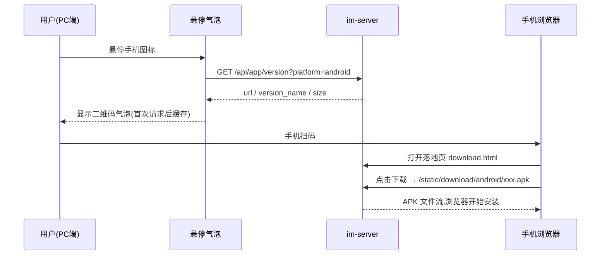
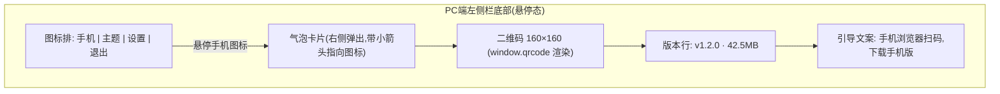

# PC端悬停显示手机端下载二维码 — 可行性方案

创建日期：2026-11-02

## 1 背景与现状

手机端 APK 目前只能通过 admin 后台上传后放在服务器静态目录里，新用户拿到安装包的路径不直观：要么由管理员手动分发文件，要么口头告知下载地址。PC 端是用户主要的登录与使用入口，微信在 PC 端左下角提供"手机悬停出二维码"的同款交互，用户已被充分教育，扫码获取手机端是认知成本最低的方式。

现状核查（已有代码依据）：

| 既有能力 | 位置 | 对本功能的意义 |
|---|---|---|
| APK 已由服务端托管 | admin 上传后落盘 `<WebDir>/static/download/android/`，服务端静态服务直接可下载（appversion.go 设计注释） | 无需新增任何下载路由 |
| 公开版本查询接口 | `GET /api/app/version?platform=android`，免登录，返回最新生效版本的 `url / version_name / size` | 二维码内容与版本号可直接取自该接口 |
| 二维码生成库 | web 端已内嵌 `qrcode-generator`，`web/js/qr.js` 的"我的二维码名片"已在用 `window.qrcode` 渲染 | 渲染逻辑照搬即可，无需引第三方库 |
| PC 端技术栈 | Electron（`im-client/pc/package.json`），UI 与 WEB 端共用 `im-client/web/` 那套页面 | 改动只落在 web 目录，PC/WEB 两端同时受益 |

## 2 可行性结论

可行。服务端零新增改动，改动范围集中在 `im-client/web/` 的一个入口按钮、一个悬停气泡卡片和一段取数渲染逻辑，外加一个建议新增的下载落地页。核心链路（版本查询、静态下载）全部复用已上线代码，回归面小。

## 3 功能需求

### 3.1 功能总览

| # | 模块 | 功能描述 |
|---|---|---|
| 1 | 悬停入口按钮 | PC 端左侧栏底部（与主题切换、设置按钮同排）新增一个"手机"图标按钮。鼠标悬停时右侧弹出二维码气泡卡片；移开后气泡延迟约 300ms 消失，鼠标移入气泡内部则保持显示（便于用户对准扫码），点击气泡外任意区域立即收起。图标样式、气泡配色跟随现有主题色变量，弹层为自绘实现，不使用系统默认弹窗。 |
| 2 | 二维码气泡卡片 | 卡片内自上而下：二维码（约 160×160）、版本信息行（"v{version_name} · {size换算MB}"）、引导文案（"手机浏览器扫码，下载手机版"）。数据来自 `GET /api/app/version?platform=android`，首次悬停时请求并缓存，之后每次悬停仅展示；接口失败或无生效版本时进入兜底态（见 #4）。 |
| 3 | 二维码内容生成 | 取接口返回的 `url`：外链模式本身是完整 http/https 地址，直接使用；相对路径 `/static/download/android/xxx.apk` 则用 PC 端当前已连接的服务器地址拼接成完整 URL。二维码指向下载落地页（见 #5）而非直链 APK。 |
| 4 | 无版本兜底 | 服务端未上传/未启用任何 android 版本，或接口请求失败时，气泡内不渲染空二维码，改为显示"暂未提供手机版下载"及失败态样式；下次悬停重新请求（失败不缓存）。 |
| 5 | 下载落地页（建议） | 新增 `web/download.html`：展示应用名、版本号、包大小、更新说明和"下载安装包"按钮，按钮指向真实 APK 地址；附一行提示"若浏览器未自动开始下载，请点击按钮；安装时如提示未知来源，请允许后继续"。落地页复用现有页面样式与主题色。 |

### 3.2 交互流程

### 3.3 气泡原型线框

兜底态：B1 位置替换为占位图形与"暂未提供手机版下载"，B2/B3 隐藏。

## 4 关键规则

**二维码内容**：一律使用完整 URL。相对路径拼接时取 PC 端实际连接的服务器地址（登录时已配置），不在前端硬编码任何域名或 IP——这样公网部署生成公网地址、局域网部署自动生成局域网地址，天然匹配部署环境。[假设 — 待确认：当前项目不存在 PC 端与服务器跨网段（如 PC 走公网、APK 仅内网可达）的部署形态；若存在，需在文档评审时补充约束]

**网络可达性**：这是本功能唯一的外部前提——手机扫码后必须能访问该 URL。公网部署无额外条件；纯局域网部署要求手机与服务器同网段。落地页可附一行检测提示（页面加载失败时浏览器自带错误页已足够，不做额外探测逻辑）。

**兼容性**：二维码指向落地页而非直链 APK，规避微信等内置浏览器对 APK 直链的拦截；扫码后引导用户在浏览器内完成下载。

**样式约束**：气泡卡片、落地页均使用现有主题色变量跟随主题变化；不涉及滚动条场景，如落地页内容超长须使用现有自绘滚动条样式。

## 5 影响分析与风险

| 项 | 影响 | 说明 |
|---|---|---|
| 服务端 | 无改动 | 版本管理、静态下载、版本检查接口均复用现有实现 |
| 现有功能 | 低 | 新增按钮为独立 DOM 节点与独立 JS 模块，不触碰聊天、登录、扫码登录链路；`window.qrcode` 为只读复用 |
| 性能 | 低 | 版本接口首次悬停请求一次并缓存，二维码为本地同步渲染，无常驻轮询、无内存增长点 |
| 安全 | 无新增风险 | 落地页与 APK 地址均为现有公开静态资源，不引入新接口、不携带任何用户态数据 |
| 已知风险 | 中 | 局域网/公网混合部署下生成的地址手机可能不可达（见第 4 节假设）；落地页未做时，直链 APK 在微信内置浏览器可能被拦截——首次上线建议同时交付落地页 |

## 6 验收标准

1. admin 上传并启用一个 android 版本后，PC 端悬停手机图标，气泡在约 300ms 内出现，二维码、版本号、包大小显示正确，二维码内容为完整可访问的落地页 URL。
2. 手机浏览器扫码能打开落地页，点击按钮后 APK 开始下载，下载完成后可正常安装。
3. 服务端无生效 android 版本时，气泡显示兜底文案，无空白二维码；重新启用版本后再次悬停可恢复显示。
4. 悬停→移开→移入气泡的显示/隐藏行为符合第 3.1 节 #1 的规则，气泡弹出与收起无明显卡顿。
5. 切换任意现有主题后，按钮与气泡配色同步变化；截图比对落地页样式与现有页面风格一致。
6. WEB 端（浏览器打开 `im-client/web/`）同样具备该入口且行为一致；扫码登录、名片二维码等既有二维码功能不受影响。
